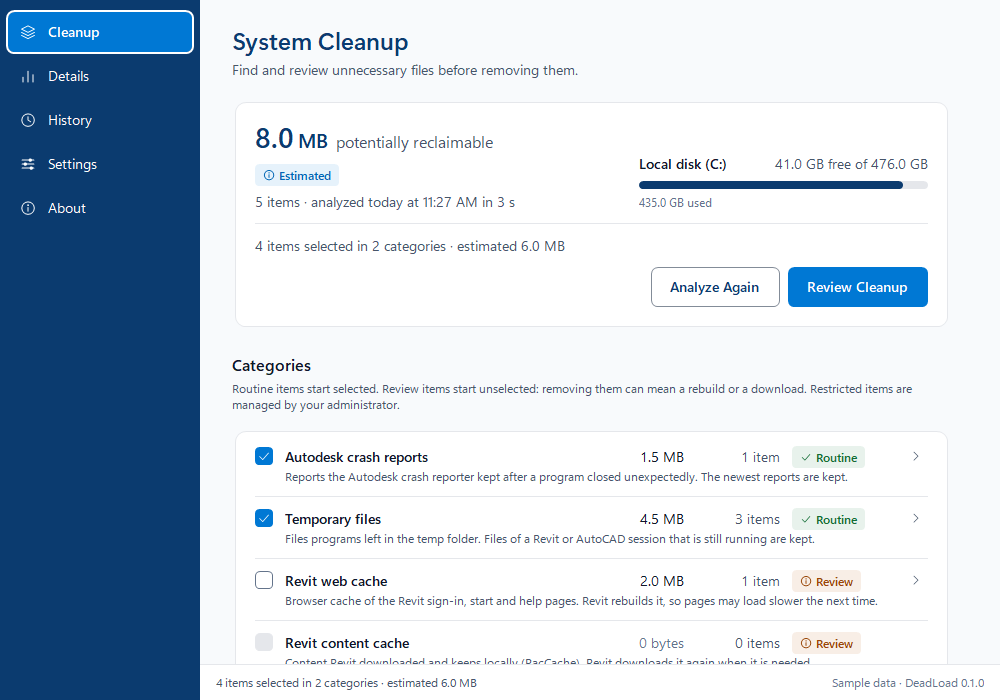

# <picture><source media="(prefers-color-scheme: dark)" srcset="site/assets/brand/deadload-mark-onDark.svg"></picture> DeadLoad

**Remove the Digital Dead Load.** A transparent Windows cleanup utility that helps identify and
remove unnecessary files without putting engineering work at risk.

[Website](https://daileng.github.io/DeadLoad/) |
[Policy generator](https://daileng.github.io/DeadLoad/policy.html) |
[Operations](docs/OPERATIONS.md) |
[Install](#install)

<p align="center">
  <picture>
    <source media="(prefers-color-scheme: dark)" srcset="site/assets/screenshots/hero-dark.png">
    
  </picture>
</p>

*The DeadLoad window after Analyze Storage (sample data). More states, light and dark: the
website's [Screenshots](https://daileng.github.io/DeadLoad/#screenshots) section.*

> In structural engineering the dead load is the permanent weight a structure carries.
> DeadLoad removes the dead load Autodesk products leave on engineering workstations,
> and keeps the records worth keeping.

DeadLoad manages disk space used by Autodesk Revit and AutoCAD on Windows workstations:
journals, worker logs, crash dumps, web, graphics and accelerator caches, autosave and temp
leftovers, installer extracts and crash reports. It runs unattended as SYSTEM from its own
scheduled tasks, applies log-management style retention (age, count, size, share of free space,
free-space floor and target), treats Revit journals as records, is configured by Group Policy,
and gives each user a tray app for self-service.

**Status: pre-release (0.1.0).** Engine, Group Policy templates, scheduler, tray app and the
signed Chocolatey package are built and tested; defaults come from measurements on seven
workstations ([docs/MEASUREMENTS.md](docs/MEASUREMENTS.md)). Install (retiring a Chocolatey-
installed Get-FreeSpace 1.3.5.0 MSI and its package record), upgrade with the tray running,
package parameters, AllSigned, a standard user's actions, uninstall and purge pass in Windows
Sandbox (83 checks). The DeadLoad window (Analyze, Review, Clean, Details, History, Settings,
About) passed an on-screen test in Windows Sandbox in light and dark. Still open: the templates
in `gpedit.msc`, a Narrator pass, a real high contrast theme and a second monitor at another DPI
([docs/design/UI-NOTES.md](docs/design/UI-NOTES.md)); no pilot has run
([docs/OPERATIONS.md](docs/OPERATIONS.md)).

## Features

- **Reclaim storage.** Removes temp files, web caches, crash reports and old installer logs past
  their age limits, and compresses Revit journals into monthly archives.
- **Analyze, review, clean.** In the DeadLoad window a user analyzes their own profile, reviews
  every path, size and reason, confirms, and sees what was recovered and what was skipped and
  why. No admin rights; nothing in the window elevates.
- **Risk tiers.** Every category is Routine (selected by default), Review (offered, not selected:
  removing it can mean a rebuild or a download) or Restricted (never cleaned from the window;
  left to the scheduled runs as policy configures).
- **Clear visibility.** Every item decision goes to the run log with the rule behind it.
  Report-only mode plans every category and changes nothing.
- **Configurable by policy.** Every setting has a Group Policy template. Policy wins over local
  settings, which win over the shipped defaults, and each effective value shows its source. The
  [policy generator](https://daileng.github.io/DeadLoad/policy.html) writes a GPO script, a
  `.reg` file or a table from a preset ([docs/RECOMMENDED-POLICY.md](docs/RECOMMENDED-POLICY.md)).
- **Measured results.** The defaults come from measurements on seven engineering workstations.
  Space recovered is counted from confirmed deletions, not estimated.

## Safety

- **Review before delete.** Report-only mode and `-WhatIf` produce the full plan and change
  nothing; run a pilot in report-only first. In the window, Clean deletes only the reviewed items
  a fresh check still selects; anything new, changed or in use is kept and reported.
- **Restricted categories are never cleaned by users.** Revit journals and the other Restricted
  categories are shown in the window but only the scheduled runs act on them, as policy configures.
- **Protected data types and folders.** Never acted on: `*.rvt *.rfa *.rte *.rft *.dwg *.dwt
  *.dws *.dxf *.bak *.nwd *.nwf *.nwc *.ifc *.pdf`. Never entered: Documents, Desktop, OneDrive,
  and Autodesk Desktop Connector, ACC Docs and BIM 360 workspaces. Reparse points are never
  traversed, and a running Revit, AutoCAD, Navisworks or DWG TrueView guards that user's
  Autodesk categories.
- **Deletion is permanent.** DeadLoad has no quarantine and no undo. Deleted files are not moved
  to the Recycle Bin and cannot be restored by DeadLoad.

Civil 3D is not supported: it was not measured.

## Install

**No public release yet.** DeadLoad is pre-release: build the Chocolatey package from source and
install it from your own feed or folder. Try it on a test machine first.

```powershell
git clone https://github.com/DailenG/DeadLoad.git
cd DeadLoad
pwsh -NoProfile -File build\Build.ps1
choco install deadload --source <folder or feed> -y --params "'/ReportOnly'"
```

The build needs PowerShell 7, the .NET 8 SDK (for the tray) and Chocolatey (to pack); without
signing configured it is an unsigned development build and says so. DeadLoad runs on Windows 10
21H2 or later and Windows 11, with Windows PowerShell 5.1 and .NET Framework 4.8. Package
parameters, upgrade, uninstall and monitoring: [docs/OPERATIONS.md](docs/OPERATIONS.md).

## See what it would do

Report-only and `-WhatIf` plan every category and change nothing:

```powershell
Import-Module .\src\engine\DeadLoad\DeadLoad.psd1
Invoke-DeadLoad -Mode Maintenance -ReportOnly -DataRoot $env:TEMP\deadload -NoEventLog
Get-DeadLoadConfiguration -Trace | Where-Object Source -ne 'Default'
```

Run elevated or as SYSTEM to include every profile. The summary object lists per-category
counts; the run log (`<DataRoot>\logs`) names the rule behind every item decision.

## Measure a workstation

`tools/Measure-AutodeskFootprint.ps1` is a read-only probe that inventories the Autodesk
footprint of a machine (sizes, ages, file types, installed products, running processes,
Revit.ini journal and cache settings). It never writes, deletes or follows reparse points, and
redacts profile folder names from its output.

```
powershell.exe -NoProfile -ExecutionPolicy Bypass -File tools\Measure-AutodeskFootprint.ps1 -RootTimeBudgetSeconds 60 -OutFile C:\Windows\Temp\deadload-probe.json
```

## Documentation

Read in this order:

1. [PRD.md](PRD.md): what and why.
2. [docs/ARCHITECTURE.md](docs/ARCHITECTURE.md): decisions, contracts, retention model, safety.
3. [docs/MEASUREMENTS.md](docs/MEASUREMENTS.md): which Autodesk paths are measured, documented,
   or still candidates.
4. [docs/PLAN.md](docs/PLAN.md): phases and acceptance tests.
5. [docs/OPERATIONS.md](docs/OPERATIONS.md): install, upgrade, uninstall, monitoring.
6. [docs/RECOMMENDED-POLICY.md](docs/RECOMMENDED-POLICY.md): the recommended configuration.

Design: [design system](docs/design/DEADLOAD_DESIGN_SYSTEM.md),
[implementation plan](docs/design/IMPLEMENTATION-PLAN.md),
[engine UI contract](docs/design/ENGINE-UI-CONTRACT.md) and
[window notes](docs/design/UI-NOTES.md).

## Tests

```
powershell.exe -NoProfile -ExecutionPolicy Bypass -File tests\Invoke-Tests.ps1
```

Runs the Pester suite (5.0 or later) under Windows PowerShell 5.1 and PowerShell 7.

## Credits

DeadLoad reuses design and code from [Get-FreeSpace](https://github.com/DailenG/get-freespace)
2.0 by Dailen Gunter (per-item retention plans, measured freed bytes, last-access tracking check).

## License

GPL-3.0. See [LICENSE](LICENSE).
