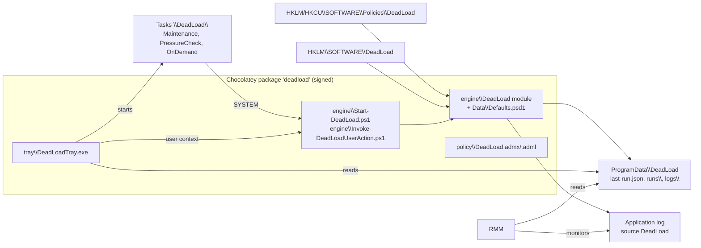

# DeadLoad: Architecture and Decision Record

Status: draft 0.1, 2026-11-03. Companion to [../PRD.md](../PRD.md). Path facts referenced here
are graded in [MEASUREMENTS.md](MEASUREMENTS.md); nothing marked CANDIDATE ships enabled until
it is MEASURED.

## 1. Overview



## 2. Decisions

Status: **Accepted** (owner approved), **Proposed** (default the build proceeds with; owner may
override), **Open** (needs the owner before the phase that uses it).

| # | Decision | Status | Rationale |
|---|---|---|---|
| D1 | New open-source repository `DeadLoad`. Vendors the good parts of Get-FreeSpace 2.0 with credit; Get-FreeSpace stays as it is. | Accepted | v3 diverges in every layer; a fork would carry a dead list-fetch design. |
| D2 | Names: product, module, event source, registry key, task folder and folders are all plain **DeadLoad** with no vendor parent: module `DeadLoad`; Chocolatey ID `deadload`; ADMX `DeadLoad.admx`, namespace `DeadLoad.Policies`, prefix `deadload`; event source `DeadLoad`; task folder `\DeadLoad\`; install `%ProgramFiles%\DeadLoad`; data `%ProgramData%\DeadLoad`; policy `HKLM\SOFTWARE\Policies\DeadLoad`. | Accepted | Vendor-neutral open-source product; deployment-specific values live only in GPO and the deploying organization's feed. |
| D3 | License GPL-3.0, inherited from Get-FreeSpace. | Proposed | Code is reused from a GPL-3.0 project. The owner is the sole author of every Get-FreeSpace commit and may relicense (for example MIT) before the first release; decide before publishing. |
| D4 | Signing: release builds are Authenticode-signed with the maintainer's Azure Trusted Signing certificate through the PowerShell `TrustedSigning` module (`Invoke-TrustedSigning`, `Test-TrustedSigningSignature`). `build/Build.ps1` signs only when that module and its environment are present; otherwise it produces an unsigned development build and says so. Credentials stay in the environment, never in the repo. | Proposed | Proven on the maintainer's build workstation. Organizations that require their own certificate can re-sign the staged payload before packing. |
| D5 | Tray: C# WinForms on .NET Framework 4.8, single exe, built with the .NET 8 SDK (SDK-style project targeting `net48`). | Proposed | Present on every Windows 10/11 machine, no runtime to deploy, signs cleanly, no console flicker. Rejected: PowerShell-hosted NotifyIcon (slow start, flicker, hard to keep alive); .NET 8 (runtime deployment or a large self-contained exe). |
| D6 | Engine host for scheduled tasks: Windows PowerShell 5.1 (`%SystemRoot%\System32\WindowsPowerShell\v1.0\powershell.exe -NoProfile -NonInteractive -ExecutionPolicy Bypass -File`). Module also supports PowerShell 7. | Proposed | 5.1 is present everywhere; `-NoProfile` avoids broken machine-wide profiles seen in the field. Signed files run under AllSigned too. |
| D7 | CollaborationCache: **disabled** by default. When enabled: pressure-only, unit = project folder (`<hub>\<project>`), 90 days untouched, never while the user runs a guarded process, honors a relocated cache (`Revit.ini` `[CloudModelCache] CacheLocation`). | Proposed | Autodesk: clearing it destroys saved-but-unsynchronized changes; the hub folder is the wrong unit. |
| D8 | `C:\Autodesk` installer extracts: **disabled** by default. When enabled: folder unit, 90 days, pressure-only, never `Network License Manager`, never a folder referenced by an installed product's `InstallSource`. | Proposed | Autodesk: deletable after install but "recommended" to keep; updates and reinstall may need it. |
| D9 | PacCache: no routine rule (Autodesk says it self-manages via `DiskCacheLimitGB`, default 10); pressure-only, keep `Logs\` and `*.json`. | Proposed | Follows Autodesk guidance; reclaimable under real pressure. |
| D10 | Default numbers: section 7. Pressure floor is the larger of **30 GB** and **5 %**, target the larger of **45 GB** and **8 %** (was 20 GB / 15 % and 30 GB / 20 %). Temp ages stay at 7 days with a 24-hour minimum; web cache 14 days; CER 30 days keeping the newest 5; ODIS logs 90 days keeping the newest 5; journal archives 180 days. | Accepted from measurements (2026-11-03), re-tuned after the pilot | Seven measured workstations have 475 to 930 GB system drives. A 15 %/20 % floor and target would mean 71 to 140 GB and 95 to 186 GB: two hosts (49 and 30 GB free) would sit permanently in pressure with targets no category can reach (measured reclaimable space per host: about 1 to 15 GB, mostly PacCache, temp and CER). 30 GB / 45 GB tracks what a Revit year install needs and keeps 2002 ("target not reachable") meaningful. Temp and cache ages cannot be re-tuned from this sample: the previous weekly wipe capped them at 7 days (MEASUREMENTS section 2). |
| D11 | Central journal archive (copy closed journals to a UNC path): designed (Copy action, section 9), **off** by default, not in v1 scope. | Open | Privacy decision (journals record user actions and model names), share ACL and server retention are the client's call. |
| D12 | Chocolatey feed: built and signed here; published to the client's internal feed by the owner. Feed URL lives only in the deployment, never in this repo. | Open | Confirm feed host, URL and who publishes. |
| D13 | Retention evaluation order: protect, then routine (age, count, size, share), then pressure tiers until the target is met. All configured limits of a rule combine with OR (any limit selects an item, logrotate semantics); protection always wins. | Proposed | Predictable, explainable per item, matches log-management practice. |
| D14 | Targets are code: shipped in `Data\Defaults.psd1`, Authenticode-signed; the engine verifies the data file has the same signer as the module when the module is signed. No runtime download. | Proposed | Fixes the inherited remote-list defect (section 13). |
| D15 | Schedule is policy-driven: the engine re-applies task triggers from the effective schedule settings at the end of each Maintenance and PressureCheck run (SYSTEM owns the tasks). | Proposed | GPO cannot edit task triggers directly; avoids a GPP scheduled-task dependency. |
| D16 | Revit `Journals` folders also hold backup RVT/RFA copies from saves to network locations (Autodesk). Protected patterns (`*.rvt`, `*.rfa`, ...) therefore apply in the journal categories. | Accepted | Autodesk documents those copies as recovery data. |
| D17 | Revit 2026+ replaced `CefCache` with `WebBrowserControl` (WebView2). Both are members of `revit.webcache`, both under `{LocalAppData}` (never `{AppData}`). | Accepted (measured 2026-11-03) | 2023 to 2025 folders hold `CefCache` only, every 2026 folder `WebBrowserControl` only, on six hosts; no Roaming copy anywhere. |
| D18 | Revit's own journal cleanup is active and prunes to 10: every Revit year folder with history holds exactly 10 (once 11) journals with consecutive session numbers far above 10 (for example 160 to 169), oldest 32 days to 6 years old, on five hosts; no `Revit.ini` sets the keys, so the defaults (more than 10 journals: delete those older than 10 days) apply. DeadLoad therefore ships `revit.ini.journalshelf` **on**, raising only `JournalShelfLife` to at least **14** days and leaving `JournalShelfCapacity` at Revit's 10, and `revit.journals` compresses after 3 days with **no** protected-newest count (D19). | Accepted (measured 2026-11-03) | Journals compressed weekly after 3 days are at most about 10 days old while raw, so a 14-day shelf life means Revit never deletes one DeadLoad still has to archive. Keeping the capacity at 10 keeps Revit's own cap for users DeadLoad cannot touch (a profile whose owner never closes Revit is skipped by the process guard): their journals stay bounded at about 10 per year instead of growing without limit. The ini is written only while that user runs no guarded process (Revit rewrites it on exit). |
| D19 | `revit.journals` protection is age only (48 hours); the "keep newest N" protection applies to deletion under pressure (`PressureKeepNewest` 20), not to compression. | Accepted | Compression is lossless and verified before the original goes. Protecting the newest 20 from compression kept them raw past Revit's 10-day shelf life, where Revit deletes them (D18). |
| D20 | `user.temp` is not process-guarded as a whole (a user who never closes Revit still gets temp cleanup), but while the profile's owner runs a guarded process its files matching `*revit*` or `*acad*` are protected (`GuardedPatterns`). | Accepted | One host held 7.4 GB of a running Revit session's temp files in `{Temp}`; a session left open for over a week would otherwise expose them to the 7-day rule. |
| D21 | Desktop Connector is not a guarded process. | Accepted (measured 2026-11-03) | `DesktopConnector.Applications.Tray.exe` ran for the signed-in user on all seven hosts, so guarding on it would exempt every signed-in user from every guarded category. Its workspace is a protected path and is never entered, which is the protection SR-2 intended. |

## 3. Repository layout

```
DeadLoad/
  PRD.md  README.md  AGENTS.md  CHANGELOG.md  LICENSE
  docs/       ARCHITECTURE.md  PLAN.md  MEASUREMENTS.md  (later: CONFIGURATION.md, OPERATIONS.md, PILOT.md)
  tools/      Measure-AutodeskFootprint.ps1     read-only field probe
  src/engine/ DeadLoad/ (DeadLoad.psd1, DeadLoad.psm1, Public/, Private/, Data/Defaults.psd1)
              Start-DeadLoad.ps1                task entry point (-Mode)
              Invoke-DeadLoadUserAction.ps1     tray entry point (-Action)
  src/tray/   DeadLoadTray.csproj, *.cs
  policy/     DeadLoad.admx, en-US/DeadLoad.adml (generated from the settings catalog)
  packaging/chocolatey/ deadload.nuspec, tools/chocolateyInstall.ps1, chocolateyUninstall.ps1, tasks/*.xml
  build/      Build.ps1 (tray build, ADMX generation, stage, sign, verify, pack), New-DeadLoadAdmx.ps1
  tests/      *.Tests.ps1 (Pester 5+), TestHelpers.psm1, Invoke-Tests.ps1 (runs 5.1 and 7)
  measurements/raw/   gitignored probe output
```

Installed layout:

```
%ProgramFiles%\DeadLoad\engine\DeadLoad\...        module
%ProgramFiles%\DeadLoad\engine\Start-DeadLoad.ps1
%ProgramFiles%\DeadLoad\engine\Invoke-DeadLoadUserAction.ps1
%ProgramFiles%\DeadLoad\tray\DeadLoadTray.exe
%ProgramFiles%\DeadLoad\policy\DeadLoad.admx, en-US\DeadLoad.adml
%ProgramData%\DeadLoad\  last-run.json  runs\<runId>.json  logs\deadload-YYYYMMDD.log
%LOCALAPPDATA%\DeadLoad\ last-user-action.json  logs\   (tray / user-context actions)
```

`%ProgramData%\DeadLoad` is created by the installer with a protected ACL: SYSTEM and
Administrators full control, Users read. The engine never reads configuration or state from a
user-writable path (SR-8).

## 4. Engine

Public commands (module `DeadLoad`):

| Command | Purpose |
|---|---|
| `Invoke-DeadLoad -Mode Maintenance\|PressureCheck\|OnDemand\|User [-ReportOnly] [-Category <id[]>] [-WhatIf]` | One run. Returns exactly one `DeadLoad.RunSummary` object. Test-only parameters `-Configuration` and `-DataRoot` inject config and redirect state. |
| `Get-DeadLoadConfiguration [-Trace]` | Effective configuration; `-Trace` returns one row per setting with `Name`, `Value`, `Source` (`Policy`, `Local`, `Default`). |
| `Get-DeadLoadStatus` | Free space, pressure state, last run summary (reads `last-run.json`; does not scan). |
| `Export-DeadLoadSupportBundle [-Days 7] [-Destination <dir>]` | Current user: zip journals, worker logs, dumps, AutoCAD error logs and CER reports from the last N days. Read-shares open files. Returns the zip `FileInfo`. |
| `Sync-DeadLoadSchedule` | Re-applies task triggers from the effective schedule settings (D15). |

Modes:

| Mode | Runs as | Does |
|---|---|---|
| Maintenance | SYSTEM | Routine rules for every enabled category, then pressure tiers if below the floor. |
| PressureCheck | SYSTEM | Exits quickly unless below the floor; then pressure tiers until the target. |
| OnDemand | SYSTEM | The policy-defined `OnDemandMode` (default Maintenance). Takes no input from the user. |
| User | current user | Current profile only, categories with `UserAction = $true` (`user.temp`, `autocad.recovery`), age floor `Tray.CleanTempMinAgeDays`. |

Internal pipeline: resolve config, enumerate profiles (`ProfileList`, SIDs `S-1-5-21-*` and
`S-1-12-1-*`), resolve roots, scan, plan (protect, routine, pressure), act, report. The plan
carries the exact item objects it measured; actions operate on those items only.

## 5. Configuration

Precedence per setting: machine policy `HKLM\SOFTWARE\Policies\DeadLoad` > local
`HKLM\SOFTWARE\DeadLoad` > `Data\Defaults.psd1`. Tray settings: machine policy > user policy
(`HKCU\SOFTWARE\Policies\DeadLoad\Tray`) > local > defaults. Invalid values (wrong type, out
of range) are ignored with event 3002 and the next source wins.

Registry layout (policy and local share it):

```
...\DeadLoad                 Enabled, ReportOnly, TimeBudgetMinutes, MaxDeleteMBPerRun,
                             MaxItemsPerRun, UseLastAccess (0 never, 1 auto), LogRetentionDays,
                             OnDemandMode (Maintenance|PressureCheck)
...\DeadLoad\Pressure        FloorPercent, FloorGB, TargetPercent, TargetGB
...\DeadLoad\Schedule        MaintenanceDays (e.g. "Sunday"), MaintenanceTime ("03:00"),
                             PressureCheckTime, RunOnlyIfIdle, AllowOnBattery
...\DeadLoad\Categories\<id> Enabled,
                             AgeDays, AgeBasis (Created|Modified|Accessed|Newest), KeepNewest,
                             MaxTotalMB, MaxSharePercent, ShareBase (Free|Disk), LimitScope
                             (Group|User|Machine), RoutineAction (None|Delete|Compress|Copy|Move),
                             Destination, ActivateBelowGB, ActivateBelowPercent,
                             MinAgeHours, ProtectNewest,
                             PressureEnabled, PressureTier, PressureAction, PressureAgeDays,
                             PressureKeepNewest
...\DeadLoad\CustomTargets   one value per target: name = id, data =
                             "Path=<template>;Include=*.log;Unit=File;AgeDays=30;Action=Delete"
...\DeadLoad\Tray            ShowTray, AllowCleanTemp, AllowRequestCleanup, AllowCollectLogs,
                             LowDiskNotifications, NotifyBelowGB, NotifyBelowPercent,
                             NotifyOnCompletion, SupportShare, CollectDays, CleanTempMinAgeDays
```

A value of 0 for a limit means "not set". The settings catalog (names, types, ranges, ADMX
category, display text) lives in one data file the config reader and the ADMX generator both
use, so the ADMX cannot drift from the engine.

Custom targets: path templates expand tokens (`{LocalAppData}`, `{AppData}`, `{Temp}`,
`{UserProfile}`, `{WindowsTemp}`, `{ProgramData}`, `{SystemDrive}`), may not contain `..`, and
must resolve under an allowed root: `{LocalAppData}`, `{Temp}`, `{WindowsTemp}`,
`{SystemDrive}\Autodesk`, `{ProgramData}\Autodesk`. Protected paths and patterns still apply.
Rejected targets are logged (3002) and skipped.

## 6. Retention model

Terms: a **category** has one or more **roots** (templates with wildcards). Each resolved root
directory is a **group** (for example one user's Revit 2026 journals). A group contains
**items**: files (`Unit = File`), immediate child folders (`Unit = Folder`, judged by the newest
activity anywhere inside), or the root itself (`Unit = Root`).

Activity of an item uses the rule's `AgeBasis`: Created, Modified, Accessed, or Newest (max of
the three). Last access counts only when NTFS records it (`NtfsDisableLastAccessUpdate` bit 0)
and `UseLastAccess` allows it; otherwise Accessed falls back to Modified and the fallback is
logged. When last access is the only reason an item was kept, the decision says so.

Evaluation per run:

1. **Protect.** An item is protected if any holds: activity newer than `MinAgeHours`; among
   the newest `ProtectNewest` of its group; matches a protected pattern or lies under a
   protected path; is a reparse point; its profile runs a guarded process; it is locked.
   Protected items are never acted on, in any phase.
2. **Routine** (Maintenance, OnDemand, User; skipped if `ActivateBelow*` is set and free space
   is above it). An unprotected item is selected if any configured limit selects it:
   - age: activity older than `AgeDays`;
   - count: rank (newest first) at or beyond `KeepNewest`;
   - size: cumulative size (newest first) beyond `MaxTotalMB`;
   - share: cumulative size beyond `MaxSharePercent` of free space (or disk size, `ShareBase`).
   Count, size and share are computed per `LimitScope`: Group (per user per product version),
   User, or Machine. Selected items get `RoutineAction`.
3. **Pressure** (any mode except User). If free space on the system volume is below the floor
   (`FloorGB` or `FloorPercent`, whichever is larger in bytes), gather unprotected items of
   categories with `PressureEnabled`, eligible when older than `PressureAgeDays` and beyond
   `PressureKeepNewest`; order by `PressureTier` ascending, then oldest first; apply
   `PressureAction` one item at a time, re-reading free space, until the target (`TargetGB` or
   `TargetPercent`, larger) is reached. If eligible items run out first, raise 2002.
   Items on other volumes are not pressure candidates.
4. **Budgets.** Time, bytes and item limits stop the run cleanly at any point (partial result).

Every item decision (kept or acted, and why) goes to the run log; the summary carries counts.

## 7. Built-in categories (initial defaults)

Evidence: M = measured on a workstation, D = Autodesk documentation, C = candidate only (see
MEASUREMENTS.md, hosts A to G measured 2026-11-03). Ship rule: a category ships **enabled** only
when its paths are M; an M category may still ship off for the reason given.

| ID | Scope | Root(s) | Unit | Protect | Routine | Pressure (tier: action, age, keep) | Default | Evidence |
|---|---|---|---|---|---|---|---|---|
| `revit.journals` | User | `{LocalAppData}\Autodesk\Revit\Autodesk Revit *\Journals` (top level only) | File | 48 h (D19) | Compress after 3 d (Modified) into `Archive\journals-YYYY-MM.zip` | 5: Delete, 2 d, keep newest 20 | On | M (2015 to 2026) |
| `revit.journals.archive` | User | `...\Journals\Archive\*.zip` | File | newest 1 | Delete after 180 d | 1: Delete, 30 d | On | design (created by DeadLoad) |
| `revit.webcache` | User | `...\Autodesk Revit *\CefCache`, `...\Autodesk Revit *\WebBrowserControl` | File | 24 h | Delete after 14 d (Newest) | 2: Delete, 3 d | On | M (CefCache 2023 to 2025, WebBrowserControl 2026) |
| `revit.paccache` | User | `{LocalAppData}\Autodesk\Revit\PacCache` (keep `Logs\`, `*.json`) | File | 24 h | none (D9) | 3: Delete, 7 d | On | M |
| `revit.collabcache` | User | `{LocalAppData}\Autodesk\Revit\Autodesk Revit *\CollaborationCache\*` (hub folders; items are project folders) | Folder (project) | 90 d | none | 6: Delete, 90 d | Off (D7) | M (2023 to 2026) |
| `revit.oldversions` | User | `{LocalAppData}\Autodesk\Revit\Autodesk Revit <year>` for years not installed (excl. `CollaborationCache\`) | Root | 30 d | Delete after 90 d | 2: Delete, 30 d | Off | M: measured folders hold only journals, dumps and model backups; `revit.journals` already treats those journals as records (compress, archive, expire), and a whole-folder delete is the owner's records decision |
| `revit.ini.journalshelf` | User | `{AppData}\Autodesk\Revit\Autodesk Revit *\Revit.ini` `[Backups]` | setting | guarded | Raise `JournalShelfLife` to at least 14 d, `JournalShelfCapacity` to at least 10 | n/a | On (D18) | M (path, absence of keys, pruning), D (semantics) |
| `autocad.graphicscache` | User | `{LocalAppData}\Autodesk\AutoCAD *\R*\*\GraphicsCache`, `{LocalAppData}\Autodesk\C3D *\*\GraphicsCache` | File | 24 h | Delete after 30 d | 2: Delete, 7 d | Off | M (parent folder; at most 34 MB of `*.acdsgccache` per user and year), D (folder name): too small to justify a default rule |
| `autocad.recovery` | User | `{Temp}` top level: `*.sv$`, `*.ac$` | File | 72 h | Delete after 30 d | 2: Delete, 7 d | Off | D (`*.sv$` none found; `*.ac$` found, 0 bytes) |
| `autocad.errorlogs` | User | `{Temp}` and `{LocalAppData}\CrashDumps`: `acad*.err`, `acadstk*.dmp`, `acad*.dmp` | File | 24 h | Delete after 30 d | 2: Delete, 7 d | Off | D (none found; `CrashDumps` is capped at 10 dumps by Windows Error Reporting) |
| `autodesk.cer` | User | `{LocalAppData}\Autodesk\CER` (items: the `<hash>` crash-signature folders) | Folder | 24 h, newest 5 | Delete after 30 d (Newest) | 2: Delete, 7 d | On | M (up to 329 MB per profile) |
| `autodesk.installlogs` | User | `{LocalAppData}\Autodesk\ODIS`: `*.log`, `*.log.*` (excluding `IHT\`) | File | 24 h, newest 5 | Delete after 90 d (Modified) | 2: Delete, 30 d | On | M (up to 365 MB per profile, mostly over 90 d) |
| `autodesk.installers` | Machine | `{SystemDrive}\Autodesk\*` (never `Network License Manager`, never an `InstallSource`) | Folder | 90 d | none | 4: Delete, 90 d | Off (D8) | M (`WI`, `Access`; 1 to 3 `InstallSource` references per host) |
| `user.temp` | User | `{Temp}` (excluding patterns owned by `autocad.*`) | File | 24 h; `*revit*`, `*acad*` while the owner runs a guarded process (D20) | Delete after 7 d | 2: Delete, 1 d | On | M |
| `windows.temp` | Machine | `{WindowsTemp}` | File | 24 h | Delete after 7 d | 2: Delete, 1 d | On | M |

Machine defaults (D10): floor 5 % or 30 GB, target 8 % or 45 GB (larger of each pair, in
bytes); time budget 20 min; no byte cap; 100,000 items per run; Maintenance weekly Sunday 03:00
with "start when available"; PressureCheck daily 12:30 plus System event 2013 (low disk).

Protected patterns (all categories except `revit.collabcache`): `*.rvt *.rfa *.rte *.rft *.dwg
*.dwt *.dws *.dxf *.bak *.nwd *.nwf *.nwc *.ifc *.pdf`. Protected paths (never entered):
`{UserProfile}\DC`, `{UserProfile}\ACCDocs`, `{UserProfile}\BIM 360`, `{UserProfile}\Documents`,
`{UserProfile}\Desktop`, `{UserProfile}\OneDrive*`, and any Desktop Connector `WorkspaceLocation`
from `HKLM`/`HKCU\SOFTWARE\Autodesk\Desktop Connector Advanced Settings`.

Guarded processes (per profile owner): `Revit`, `RevitWorker`, `acad`, `AcCoreConsole`,
`Roamer`, `dwgviewr` (D21). Machine-scope installer category is also guarded by `AdODIS*`,
`AdskAccess*`, `Setup`, `Installer` run by any owner.

## 8. Safety model

- **Reparse points.** Enumeration is manual and non-recursive (`DirectoryInfo` per folder, explicit
  stack). Every entry is checked for `FileAttributes.ReparsePoint` before use; reparse points are
  skipped and reported (3001), never followed, never deleted. Before a root is used, every path
  component from the profile directory (or volume root) down to the root is checked the same
  way; one reparse component disqualifies the root.
- **Deletion primitive.** Files are deleted by full path (`[IO.File]::Delete`) after re-checking:
  still exists, not a reparse point, attributes unchanged, activity not newer than at scan time,
  and an exclusive open succeeds (else `Locked`). Directories are removed only when empty,
  deepest first, non-recursively. `Remove-Item -Recurse` is never used.
- **Process guard.** Owner SIDs of running processes (`Win32_Process.GetOwnerSid`) are mapped to
  profiles. A profile whose owner runs a guarded process is skipped for guarded categories; the
  check is refreshed before each group is acted on.
- **Budgets** stop the run between items, never mid-item.
- **No network.** The engine contains no HTTP client calls. Copy and Move are the only operations
  that may touch a UNC path, and only the configured destination.
- **Integrity.** When the module manifest is signed, `Data\Defaults.psd1` and the settings catalog
  must carry a valid signature from the same certificate, else the run fails with 3003.

## 9. Actions

| Action | Behavior |
|---|---|
| Delete | Section 8 primitive. Freed bytes are measured from confirmed deletions. |
| Compress | Append the file to the group archive (`ArchivePath` template, default `{Root}\Archive\journals-{yyyy}-{MM}.zip` by item month). Entry name collisions get a timestamp suffix. Close, reopen read-only, compare entry length and SHA-256 with the source, then delete the source. Freed bytes = source size minus archive growth. Uses `System.IO.Compression` (available on 5.1). |
| Copy | Copy to `Destination` (tokens `{Computer}`, `{User}`, `{Category}`, `{Version}`, relative path preserved); verify length and SHA-256; source kept. Idempotent: an identical destination file is a no-op. |
| Move | Copy, verify, then the Delete primitive on the source. |

## 10. Monitoring contract

Event log: Application, source `DeadLoad` (registered by the installer; if absent, the engine
logs to file only and the summary says so).

| ID | Level | Meaning |
|---|---|---|
| 1000 | Info | Run started (mode, version, report-only) |
| 1001 | Info / Warning / Error | Run summary; message ends with the summary JSON |
| 1002 | Info | Category result |
| 1003 | Info | Effective configuration with sources |
| 2000 | Warning | Disk pressure entered (free, floor) |
| 2001 | Info | Pressure target reached |
| 2002 | Warning | Pressure target not reachable (eligible items exhausted) |
| 3000 | Error | Run error |
| 3001 | Warning | Items skipped (aggregated per run: reparse, locked, process, changed) |
| 3002 | Warning | Configuration value or custom target rejected |
| 3003 | Error | Integrity check failed; run refused |
| 4000 | Info | OnDemand run requested |
| 4001 | Info | User temp cleanup (tray) |
| 4002 | Info | Support bundle created (tray) |

`last-run.json` (also returned as the run summary object):

```
SchemaVersion, Product, Version, RunId, Computer, Mode, StartTime, EndTime (ISO 8601 UTC),
DurationSeconds, ReportOnly, WhatIf, Result (Success|Partial|Failed|Skipped|Disabled), Reason,
Volume { Drive, SizeBytes, FreeBytesBefore, FreeBytesAfter, FloorBytes, TargetBytes,
         PressureBefore, PressureAfter, TargetReached },
Budget { TimeExhausted, BytesExhausted, ItemsExhausted },
Totals { ScannedCount, ScannedBytes, ProtectedCount, CandidateCount, CandidateBytes,
         DeletedCount, CompressedCount, CopiedCount, MovedCount, FreedBytes, SkippedCount,
         FailedCount },
Categories [ { Id, Enabled, Groups, ScannedCount, ScannedBytes, ProtectedCount,
               CandidateCount, CandidateBytes, ActedCount, FreedBytes, SkippedCount,
               FailedCount } ],
Skips [ { Path, Category, Reason, Detail } ]        (first 200),
Failures [ { Path, Category, Message } ]            (first 200),
Configuration [ { Name, Value, Source } ],
LogPath
```

Paths in the report are tokenized per profile alias where they contain a user name.

## 11. Scheduler

Tasks in `\DeadLoad\`, all running as SYSTEM, highest privileges, action
`powershell.exe -NoProfile -NonInteractive -ExecutionPolicy Bypass -File "<install>\engine\Start-DeadLoad.ps1" -Mode <mode>`:

| Task | Triggers | Settings |
|---|---|---|
| Maintenance | Weekly per policy; start when available | Stop after 1 h; no battery start unless allowed; optional idle condition |
| PressureCheck | Daily per policy; System log event 2013 (low disk) | Stop after 30 min |
| OnDemand | none | Security descriptor grants Authenticated Users read and execute (start), not write |

Tasks are registered through the Task Scheduler COM API (`Schedule.Service`), which accepts the
security descriptor; XML templates live in the package.

## 12. Tray

`DeadLoadTray.exe`, per user, non-elevated, started from `HKLM\...\Run` unless `ShowTray` is
off. Reads `%ProgramData%\DeadLoad\last-run.json` and tray policy; polls free space every
10 minutes.

| Action | Mechanism |
|---|---|
| Clean my temp files | `powershell.exe ... -File engine\Invoke-DeadLoadUserAction.ps1 -Action CleanTemp`; JSON result on stdout |
| Request a cleanup | Starts `\DeadLoad\OnDemand` via `Schedule.Service` |
| Collect my logs for support | `-Action CollectLogs`; zip to Desktop or `SupportShare`; shows the path |
| Open my journals folder | Newest `%LOCALAPPDATA%\Autodesk\Revit\Autodesk Revit <year>\Journals` |
| View last report | Read-only window over `last-run.json` |

Notifications: low disk (below `NotifyBelowGB`/`Percent`, at most every 4 h), cleanup completed
(when `last-run.json` changes and `NotifyOnCompletion`).

## 13. Packaging

Chocolatey package `deadload` (version = engine version):

- `chocolateyInstall.ps1`: copy payload to `%ProgramFiles%\DeadLoad`; create
  `%ProgramData%\DeadLoad` with the protected ACL; register the event source; register or
  replace the three tasks; set the Run key for the tray; write `HKLM\SOFTWARE\DeadLoad`
  `Version` and `InstallPath`; apply package parameters; retire legacy (uninstall MSI
  `{DCD33BCE-C996-4E9B-9044-B77CCCB33EAD}`, upgrade code `{21C13EEE-E023-4C8E-BC5B-048D2B669921}`,
  remove `%ProgramFiles%\Get-FreeSpace` remnants).
- `chocolateyUninstall.ps1`: remove tasks, Run key, event source; keep logs and archives unless
  `/PurgeData`.
- Parameters: `/NoTray`, `/ReportOnly` (sets local `ReportOnly=1`), `/InstallAdmxLocally`,
  `/PurgeData`.
- Scripts are invoked with `-File`, never inline `-Command`.
- Every `.ps1`, `.psm1`, `.psd1` and `.exe` is signed and verified before `choco pack`.

## 14. Inherited defects and their fixes

From the code review of Get-FreeSpace 2.0 (client fork at `1d39215`):

| Defect | Fix in DeadLoad |
|---|---|
| Remote, unauthenticated deletion list run as SYSTEM | D14: targets ship signed; policy adds only under allowlisted roots |
| Reparse points traversed | Section 8 |
| CollaborationCache deleted weekly; hub folder judged as the unit | D7 |
| No running-process guard | Section 8, per profile |
| Log prose on the output stream | Prose via `Write-Verbose`/`Write-Information`; output is one object |
| Version folder pattern `*Revit*202*` misses 2019 and 2030+ | Roots match `Autodesk Revit *`; version parsed with `(\d{4})` |
| Profiles from `C:\Users\*` | `ProfileList` |
| PacCache and Windows Temp at retain 0 | D9; minimum ages in section 7 |
| `C:\Autodesk` at retain 0 | D8 |
| Last access inflated by scanners | Policy `UseLastAccess`; decision log names last access when it is the only reason |
| No budgets, no re-check at delete time | Sections 6 and 8 |

## 15. Reused from Get-FreeSpace 2.0 (credit: Dailen Gunter, GPL-3.0)

- The plan carries the exact items it measured (`Get-FSTargetPlan` -> `Remove-FSPlanItem`).
- Freed bytes are measured from confirmed deletions, not estimated.
- `SupportsShouldProcess` / `-WhatIf` on every state-changing function.
- `Test-FSLastAccessTracking` (bit 0 of `NtfsDisableLastAccessUpdate`).
- Activity as the newest of write, create and (when tracked) access.
- Pester suite on 5.1 and 7, sandbox-per-test pattern.
